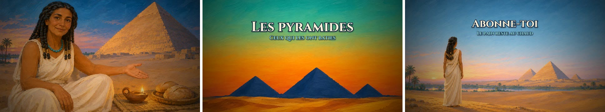
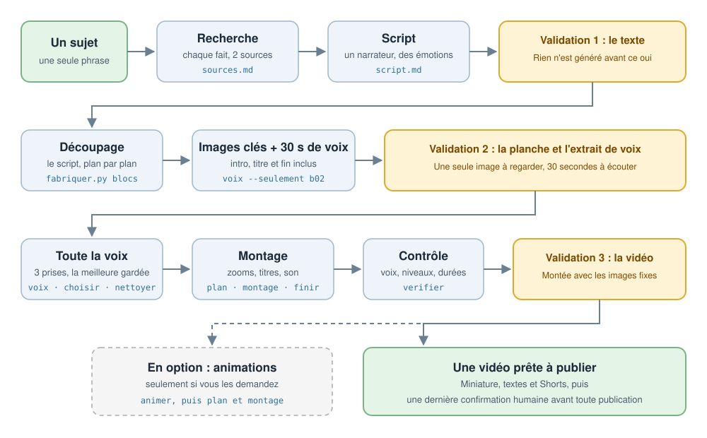
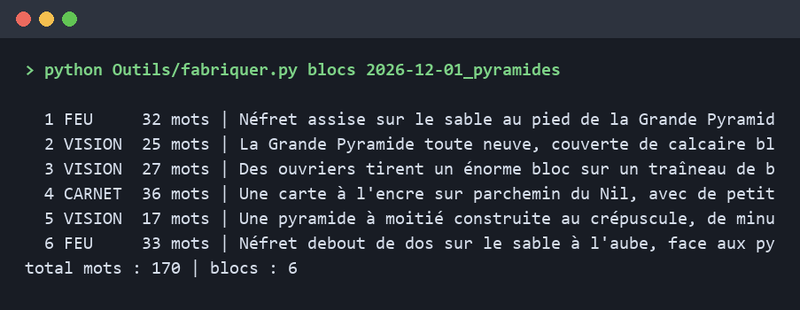
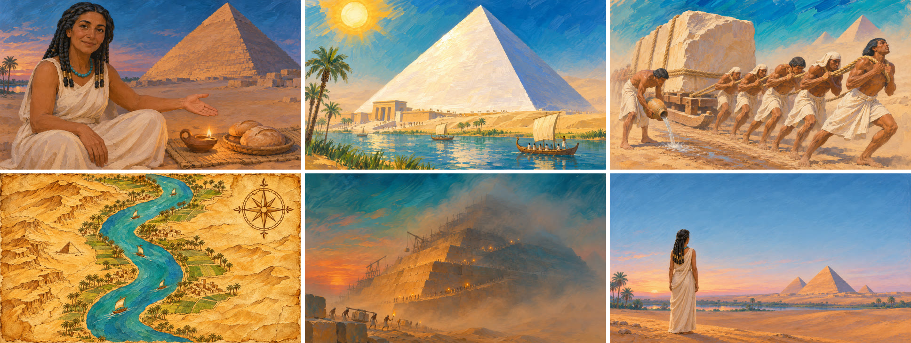
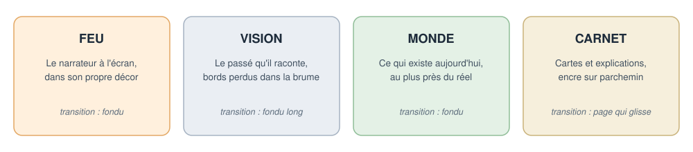
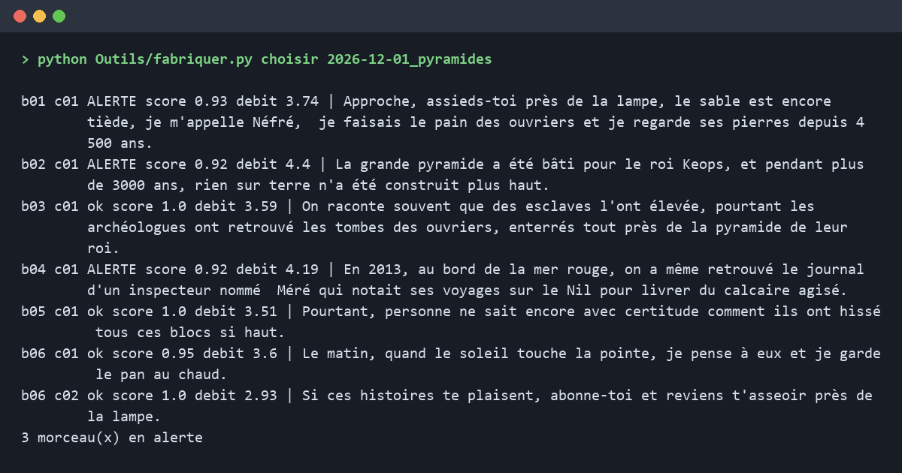
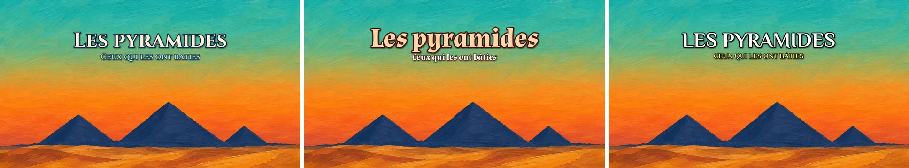
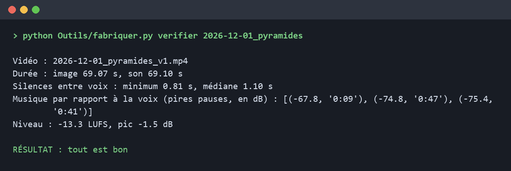
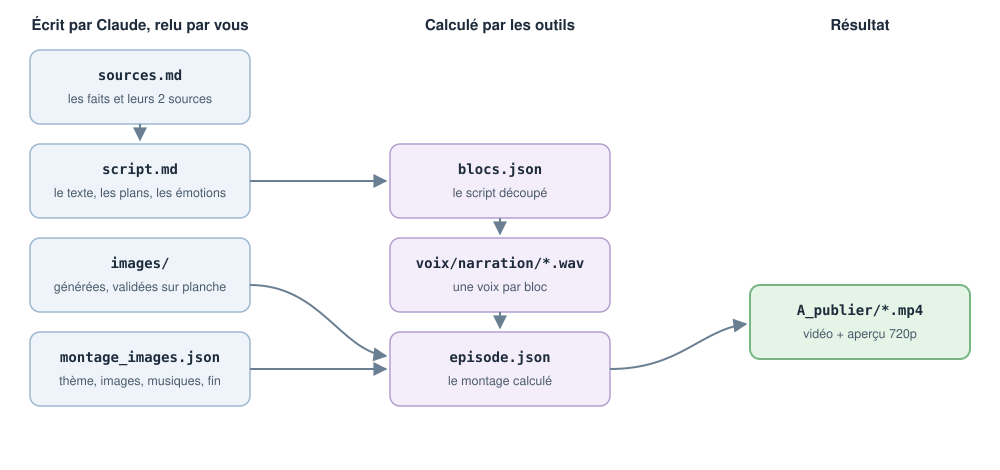

# OpenNarrate

[English](README.md) · [Démarrage rapide](Docs/quickstart.fr.md)

**Un sujet en entrée. Une vidéo racontée en sortie.**

[](LICENSE)

OpenNarrate fabrique des vidéos racontées de 10 à 20 minutes, avec un vrai narrateur, des faits vérifiés, des images et un montage complet. Vous pilotez tout en français, en parlant à [Claude Code](https://claude.com/claude-code). Vous relisez aux moments importants, et rien n'est publié sans votre accord.

[](Exemples/pyramides/apercu.mp4)

*Trois images de la [vidéo d'exemple](Exemples/pyramides/apercu.mp4), entièrement fabriquée avec cet outil. Tous ses fichiers sont dans [`Exemples/pyramides/`](Exemples/pyramides/).*

> Là où la plupart des outils produisent des Shorts en quelques minutes, OpenNarrate vise les **histoires qu'on écoute jusqu'au bout**.

## En 30 secondes

Vous écrivez une phrase à Claude Code :

```text
Fais une vidéo sur les pyramides d'Égypte.
```

Claude cherche les faits, écrit le texte, fait générer les images et la voix, puis monte la vidéo. Il s'arrête **trois fois** pour vous demander votre avis :



| Qui | Ce qu'il fait | Temps pour une vidéo de 15 min |
|---|---|---|
| **Vous** | Vous lisez le texte, regardez une planche d'images, écoutez un extrait, regardez la vidéo | 20 à 30 min |
| **Claude Code** | Recherche, écriture, direction de chaque étape | Sur votre abonnement |
| **Votre PC** | Voix, montage, contrôles | Environ 2 h de calcul |

Les animations sont une option. Par défaut, chaque image reçoit un zoom lent : c'est plus rapide, et le résultat tient très bien.

## Un exemple réel, étape par étape

Tout ce qui suit vient de la même vidéo sur les pyramides. Les captures reprennent le texte réellement affiché par les commandes, sans les lignes de chemins de fichiers.

### 1. Les faits, chacun avec deux sources

Claude remplit une fiche [`sources.md`](Exemples/pyramides/sources.md). Ce qui n'est pas confirmé est écarté et noté. Extrait réel :

| # | Fait | Statut | Sources |
|---|---|---|---|
| 3 | Le journal de l'inspecteur Merer, retrouvé en 2013 près de la mer Rouge, raconte le transport de calcaire vers Gizeh par bateau | officiel | Wikipedia, Amusing Planet |
| 4 | Les spécialistes ne sont pas d'accord sur la méthode employée pour hisser les blocs | contradiction | World History Encyclopedia, BBC Science Focus |

> **Écarté :** la fin exacte du record de hauteur, car selon les sources c'est la cathédrale de Lincoln vers 1300 ou la tour Eiffel en 1889. Le script dit seulement « plus de trois mille ans ».

### 2. Le script, avec un narrateur et des émotions

Chaque sujet a son propre narrateur, un personnage inventé. Ici, Néfret, boulangère des ouvriers de Gizeh. Le fichier [`script.md`](Exemples/pyramides/script.md) décrit chaque plan et l'émotion de la voix :

```markdown
📜 CARNET — Une carte à l'encre sur parchemin du Nil, avec de petites barques.

> {confidence} En deux mille treize, au bord de la mer Rouge, on a même retrouvé
> le journal d'un inspecteur nommé Merer. Il y notait ses voyages sur le Nil,
> quand il livrait du calcaire à Gizeh. [#3]
```

`{confidence}` règle le ton de la voix, et `[#3]` renvoie au fait n° 3 de la fiche.

**C'est la validation 1.** Rien n'est généré tant que vous n'avez pas dit oui. Le script est ensuite découpé en plans :



### 3. Les images, sur une seule planche

Vous regardez tout d'un coup. Le narrateur est bien visible dès la première image, et chaque image appartient à une famille :





### 4. La voix, réécoutée par la machine

Chaque morceau de texte est généré trois fois. Un outil de transcription réécoute chaque prise, garde la meilleure et signale ce qui cloche :



Sur cette première passe, l'outil a compris « Méré » pour Merer et « agisé » pour « à Gizeh ». Le correctif tient en une ligne de réglage, utilisée seulement au moment de générer la voix :

```json
"prononciation": {"Néfret": "Néfrète", "Merer": "Mérère", "Gizeh": "Guizèh"}
```

Seuls les blocs concernés sont refaits. **C'est la validation 2 :** la planche, plus 30 secondes de voix à écouter.

### 5. Des titres propres à chaque vidéo

Une police, des couleurs et un placement choisis selon le sujet. Voici le même titre avec trois réglages :



```json
"theme_titres": {
  "police": "Polices/Cinzel.ttf", "casse": "telle_quelle",
  "couleur": [252, 240, 214], "couleur_sous": [150, 226, 222], "contour": [18, 34, 62]
}
```

### 6. Le montage et le contrôle automatique

Avant de vous montrer la vidéo, l'outil vérifie les durées, les silences entre les phrases et les niveaux sonores :



**C'est la validation 3.** Ce contrôle ne remplace pas votre oreille : la machine ne sait pas si c'est beau.

## Ce qu'il y a dans un projet



Tous les réglages d'une vidéo tiennent dans un seul fichier, [`montage_images.json`](Exemples/pyramides/montage_images.json).

## Installation

| Il vous faut | Pour quoi |
|---|---|
| Une carte NVIDIA avec 12 Go de mémoire (testé sur RTX 4070 Ti) | La voix |
| Python 3.12 et [FFmpeg](https://ffmpeg.org/) | Les outils et le montage |
| [Claude Code](https://claude.com/claude-code) | Piloter le tout |
| [Codex CLI](https://github.com/openai/codex) avec un compte ChatGPT | Les images |
| En option : [ComfyUI](https://github.com/comfyanonymous/ComfyUI), Wan 2.2 14B I2V et RealESRGAN | Les animations, environ 2 h de calcul en plus |

1. Installez les dépendances :
   ```bash
   pip install -r requirements.txt
   ```
2. Copiez `config.exemple.json` en `config.json` et remplissez vos chemins.
3. Ajoutez une police (`Polices/README.md`), un narrateur (`Narrateurs/README.md`) et, si vous le souhaitez, des musiques (`Musique/README.md`).
4. Ouvrez ce dossier dans Claude Code et écrivez : « Fais une vidéo sur <votre sujet> ».

## Les commandes

Claude les lance pour vous. Elles restent disponibles à la main :

```bash
python Outils/fabriquer.py nouveau 2026-12-01_sujet
python Outils/fabriquer.py blocs <projet>
python Outils/fabriquer.py voix <projet>
python Outils/fabriquer.py choisir <projet>
python Outils/fabriquer.py nettoyer <projet>
python Outils/fabriquer.py plan <projet>
python Outils/fabriquer.py montage <projet>
python Outils/fabriquer.py finir <projet>
python Outils/fabriquer.py verifier <projet>
```

Pour animer des plans, lancez `python Outils/fabriquer.py animer <projet>` avant `plan`. Sans clip, le montage utilise les images fixes avec un zoom lent.

## Pour aller plus loin

| Document | Sujet |
|---|---|
| [`Docs/workflow.md`](Docs/workflow.md) | Le déroulé complet et les règles de sécurité |
| [`Docs/recherche.md`](Docs/recherche.md) | Vérifier les faits |
| [`Docs/ecriture.md`](Docs/ecriture.md) | Écrire un script fluide |
| [`Docs/voix.md`](Docs/voix.md) | La voix et ses contrôles |
| [`Docs/images.md`](Docs/images.md) | Images, intro, fin et animations |
| [`Docs/son_et_montage.md`](Docs/son_et_montage.md) | Son, titres, fin de vidéo, contrôle |
| [`Docs/droits.md`](Docs/droits.md) | Droits et déclaration de l'IA |
| [`Docs/publication.md`](Docs/publication.md) | Habiller la chaîne, ordre et heure de sortie, réglages de chaque vidéo |

## Limites actuelles

- Guide de démarrage et aide des commandes disponibles en français et en anglais. Les guides avancés sont principalement en français.
- Testé sur un seul PC : Windows 11 et RTX 4070 Ti.
- La génération des animations n'a pas été retestée depuis qu'OpenNarrate est devenu un projet séparé.
- Les contrôles sont automatiques, mais seul un humain peut juger de la voix et du rythme.

## Utiliser OpenNarrate de façon responsable

Déclarez toujours le contenu généré par IA sur les plateformes. Utilisez seulement des voix, images et musiques dont vous avez les droits, et ne clonez jamais la voix d'une personne sans son accord écrit. Voir [`Docs/droits.md`](Docs/droits.md).

## Licence

Le code et la documentation sont sous [licence MIT](LICENSE). Les outils et modèles utilisés (Chatterbox, Codex, FFmpeg, Wan 2.2, ComfyUI, RealESRGAN…) ne sont pas inclus et gardent leurs propres licences : vérifiez-les avant un usage commercial.
