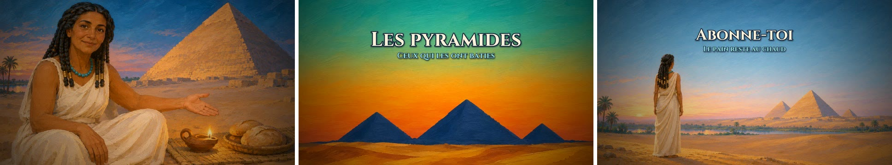
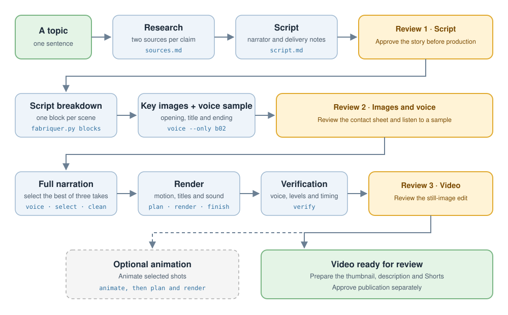

# OpenNarrate

[Français](README.fr.md) · [Quickstart](Docs/quickstart.en.md) · [MIT license](LICENSE)

**Turn a researched script into a narrated video.** OpenNarrate helps you produce long-form stories with illustrated scenes, expressive narration, a complete edit, and vertical excerpts.

[](Exemples/pyramides/apercu.mp4)

[Watch the 69-second pyramids demo (French audio)](Exemples/pyramides/apercu.mp4) · [Browse the example project (French)](Exemples/pyramides/)

## How it works

You can direct the production through Claude Code or run the individual steps yourself. Bring your own images and narration, or generate illustrations with Codex and narration locally with Chatterbox. Faster Whisper reviews the voice takes and aligns words for Short captions. FFmpeg produces the video.



Review the script first, then the images and a voice sample, then the edited video. Still images with gentle camera movement are the default. Animation through ComfyUI is optional.

To use the [`videomaker` agent](.claude/agents/videomaker.md), run `claude --agent videomaker` from the repository root and ask, for example, “Make an English video about the Egyptian pyramids.” If you provide only a topic, the agent asks for the narration language. It records approvals and the next action in the episode's `A_REPRENDRE.md`, so you can resume the project in a later session.

## Example: from script to video

Each shot in `script.md` starts with a visual cue. The quoted lines contain the narration, and `[#3]` points to a claim in `sources.md`. Here's an English adaptation of one shot from the pyramids demo:

```markdown
📜 CARNET — A map of the Nile, with small boats carrying limestone.

> {confidence} Merer's journal describes carrying limestone by boat to Giza. [#3]
```

The `blocks` command turns the script into numbered blocks. In `montage_images.json`, assign one or more image aliases to each block. Once the images and narration are ready, run:

```powershell
python Outils/fabriquer.py check my-story
python Outils/fabriquer.py plan my-story
python Outils/fabriquer.py render my-story
python Outils/fabriquer.py finish my-story
python Outils/fabriquer.py verify my-story --report
```

The MP4 and its 720p preview appear in `A_publier/`. The episode's `verification.json` lists audio and video warnings and maps voice blocks to timestamps. Browse the demo's [script](Exemples/pyramides/script.md), [source notes](Exemples/pyramides/sources.md), and [image configuration](Exemples/pyramides/montage_images.json) to see how they fit together.

## Try the renderer

The production workflow was developed on **Windows with an NVIDIA GPU**. To try rendering on a CPU, install Python 3.12, NumPy and FFmpeg with FFprobe available on your PATH. Run this from the repository root:

```powershell
python -m pip install numpy
python Tests/smoke_render.py
```

The test uses generated color cards and tones, then checks that the renderer reuses unchanged shots. For voice generation, setup checks and your first real project, follow the [English quickstart](Docs/quickstart.en.md).

## Commands and languages

Commands are available in English and French. The episode's narration language is independent of the command you use.

| Task | English | French |
| --- | --- | --- |
| Create a project | `new` | `nouveau` |
| Split the script | `blocks` | `blocs` |
| Generate voice takes | `voice` | `voix` |
| Select and clean takes | `select`, `clean` | `choisir`, `nettoyer` |
| Render and review | `render`, `finish`, `verify` | `montage`, `finir`, `verifier` |

```powershell
python Outils/fabriquer.py --help
python Outils/fabriquer.py new 2026-12-01_my-story --language en
```

Use `--language fr` for a French project and `--help --ui-language fr` to read the command help in French. Some production messages and advanced guides are still in French.

## Project files and outputs

Edit `script.md` for the narration and `sources.md` for research and credits. Use `montage_images.json` to map images to script blocks and configure titles, music and the narrator. The tools generate a timeline, an MP4, a 720p preview and, on request, a JSON verification report. The [Shorts workflow (French)](Docs/shorts.md) turns selected passages into captioned vertical videos.

OpenNarrate code and documentation are licensed under the [MIT license](LICENSE). Check the separate terms for external models, tools and media you choose to use. The [rights guide (French)](Docs/droits.md) covers voice references, media and AI disclosures.
